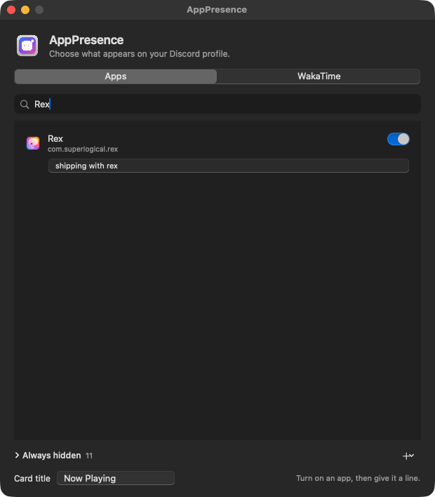

<p align="center">
  
</p>

<h1 align="center">AppPresence</h1>

<p align="center">Show the app you're using on Discord, with its real icon.</p>

A tiny macOS menu bar app. No bot, no token, no login, and nothing uploaded to the Discord Developer Portal.

## Features

- **Only what you choose.** Nothing appears by default. Turn on an app and it shows. Everything else stays private, which matters when the app in front is not something you want on your profile.
- **Custom status lines.** Each app gets its own line, like `shipping with` for Rex or `conducting agents` for Conductor. The app name sits underneath, so there is no duplication. Seeded for 50+ apps, editable per app.
- **Real logos, not placeholders.** Every app in `/Applications` is exported at 512px and served from this repo. Rex, Conductor, Arc, Ghostty and 263 others each show their actual icon.
- **Elapsed time from launch.** Discord's timer counts from when the app actually opened, not from when you last focused it.
- **A second card for WakaTime.** Your weekly leaderboard rank and today's coding total, then your daily average and 7-day total, with editor, project count, OS and AI lines on hover, plus Dashboard and Leaderboard buttons. It uses the Watching activity type, which is how it coexists with the Playing card.
- **Hard blocks.** Mark an app as never, like Discord or 1Password, and it can never appear even if you enable everything else.
- **Stays put.** Switching to a hidden app does not wipe your status. The last allowed card stays until another allowed app takes over.
- **Menu bar only.** No dock icon, no window, no polling loop.
- **SQLite.** Policies, phrases, and settings live in one small database at `~/Library/Application Support/AppPresence/apppresence.sqlite3`.

<p align="center">
  
</p>

## Install

Requires macOS 13 or newer and the Command Line Tools. Full Xcode is not needed.

```bash
git clone https://github.com/aryanranderiya/app-presence.git
cd app-presence
./scripts/install.sh
```

That builds, signs ad-hoc, installs to `~/Applications/AppPresence.app`, and launches it.

## Set up

1. Click the menu bar item and choose **Settings…**.
2. Turn on the apps you want on your profile. Search makes this quick.
3. Give each one a status line. Leave it empty to show just the app name.
4. For the WakaTime card, create a second Discord application and paste its Application ID under the WakaTime tab.

Discord shows one card per application, which is why the stats card needs its own ID. Spotify is handled by Discord itself and needs nothing from this app.

## How it works

- `NSWorkspace.didActivateApplicationNotification` fires the instant the frontmost app changes.
- The bundle ID is looked up in SQLite. Only a `show` policy produces a presence, so the allowlist is the default and a hidden app never reaches Discord.
- The presence carries a custom header, the app name, the phrase, the icon URL, a launch timestamp, and up to two buttons.
- A single-slot scheduler sends `SET_ACTIVITY` over Discord's local IPC socket. A 250ms floor collapses a Cmd+Tab storm, and an identical payload is never sent twice.
- The WakaTime card uses a second connection with its own application ID and the Watching type. Discord shows one activity per category, so Playing and Watching can both render. It refreshes every 5 minutes.

## Adding an app

```bash
swift scripts/export-icons.swift icons   # re-exports every app in /Applications
git add icons && git commit -m "icons" && git push
```

Then turn it on in Settings and add a line. The new icon path resolves immediately because it has never been cached.

## Privacy

Nothing leaves your machine except the app name, your phrase, and the icon URL, sent to Discord through its local socket. An app that is off or marked never is not sent at all. The WakaTime card reads your local `~/.wakatime.cfg` key and calls WakaTime directly.

## Troubleshooting

- **No icon in Discord.** That app has no file in `icons/`. Run the exporter, push, and switch apps again.
- **Nothing shows up.** Check `~/Library/Application Support/AppPresence/app.log`. It records every send, clear, and reconnect.
- **Menu bar item missing.** macOS hides new items behind the `<<` chevron when the bar is full. Remove an item or use a menu bar manager.
- **WakaTime card missing.** It needs its own Discord application ID. One application can only set one card.
- **Wrong app name.** Add an entry to `overrides` in `Models.swift`.

## Project layout

| Path | Role |
| --- | --- |
| `Sources/AppPresence/main.swift` | Status item, menu, wiring |
| `Sources/AppPresence/SettingsView.swift` | SwiftUI settings, allowlist and phrases |
| `Sources/AppPresence/Store.swift` | SQLite policies, phrases, settings |
| `Sources/AppPresence/FocusMonitor.swift` | Frontmost app changes |
| `Sources/AppPresence/Models.swift` | `AppInfo`, presence model, name overrides |
| `Sources/AppPresence/PresenceScheduler.swift` | Coalescing and duplicate suppression |
| `Sources/AppPresence/DiscordRPC.swift` | Unix socket, framing, reconnect |
| `Sources/AppPresence/WakaTimeService.swift` | Stats card and rotation |
| `scripts/export-icons.swift` | 512px PNG export from installed apps |
| `scripts/install.sh` | Build, sign, install, launch |
