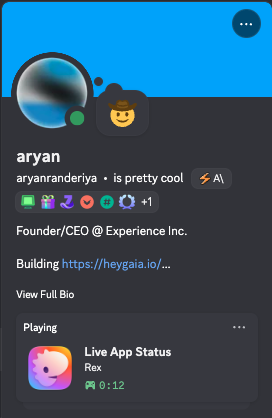

<p align="center">
  
</p>

<h1 align="center">AppPresence</h1>

<p align="center">Show the app you're using on Discord, with its real icon.</p>

A tiny menu bar app for macOS. No bot, no token, no login, and nothing uploaded to the Discord Developer Portal.

## Features

- **Real logos, not placeholders.** Every app in `/Applications` is exported at 512px and served from this repo. Rex, Conductor, Arc, Ghostty and 263 others each show their actual icon.
- **Instant switching.** The presence changes the moment you Cmd+Tab. No polling, no 15 second refresh.
- **Elapsed time from launch.** Discord's timer counts from when the app actually opened, not from when you last focused it.
- **Private by default.** Password managers, Keychain, Messages, Signal, WhatsApp and anything with `bank` in its bundle ID are never sent.
- **Leaves when you leave.** The presence clears when the screen sleeps or the session locks, and comes back when you do.
- **Survives Discord restarts.** If Discord quits or starts after the app, the socket reconnects and resends the current app.
- **Menu bar only.** No dock icon, no window, no background CPU spin. The menu shows the current app and how long it has been open.
- **Adding an app is adding a file.** The bundle ID is the filename, so the repo is the registry. No mapping table, no rebuild.

## Install

Requires macOS 13 or newer and the Command Line Tools. Full Xcode is not needed.

```bash
git clone https://github.com/aryanranderiya/app-presence.git
cd app-presence
./scripts/install.sh
```

That builds, signs ad-hoc, installs to `~/Applications/AppPresence.app`, and launches it. Click the menu bar item to pause, launch at login, or quit.

### Use your own Discord application

The repo ships with one client ID, which means everyone would share the same `Live App Status` header. For your own:

1. Create an application at [discord.com/developers/applications](https://discord.com/developers/applications).
2. Copy its **Application ID**.
3. Replace `clientID` in `Sources/AppPresence/DiscordRPC.swift`.
4. Run `./scripts/install.sh` again.

The application name you choose becomes the header line above your app name.

## How it works

- `NSWorkspace.didActivateApplicationNotification` fires the instant the frontmost app changes.
- The bundle ID resolves to a name, a launch date, and an icon URL of `https://cdn.jsdelivr.net/gh/aryanranderiya/app-presence@main/icons/<bundle-id>.png`.
- A single-slot scheduler sends `SET_ACTIVITY` over Discord's local IPC socket. A 250ms floor collapses a Cmd+Tab storm into the newest app, and identical consecutive states are dropped.
- Discord accepts external URLs for `large_image` and rewrites them to `mp:external/...`, so the 300 asset limit does not apply.

## Adding an app

```bash
swift scripts/export-icons.swift icons   # re-exports every app in /Applications
git add icons && git commit -m "icons" && git push
```

The new path resolves immediately because it has never been cached. Changed files can take a few minutes to propagate through the CDN.

## Privacy

Nothing leaves your machine except the app name and its icon URL, sent to Discord through its local socket. The bundle ID is used for the filename, so a private app never reaches Discord at all. To hide another app, add its bundle ID to `privateBundleIDs` in `Models.swift`.

## Troubleshooting

- **No icon in Discord.** That app has no file in `icons/`. Run the exporter, push, and switch apps again.
- **Nothing shows up.** Check `~/Library/Application Support/AppPresence/app.log`. It records every send, every clear, and every reconnect.
- **Menu bar item missing.** macOS hides new items behind the `<<` chevron when the bar is full. Remove an item or use a menu bar manager.
- **Wrong app name.** Add an entry to `overrides` in `Models.swift`.

## Project layout

| Path | Role |
| --- | --- |
| `Sources/AppPresence/main.swift` | Status item, menu, sleep and lock handling |
| `Sources/AppPresence/FocusMonitor.swift` | Frontmost app changes |
| `Sources/AppPresence/Models.swift` | `AppInfo`, name overrides, privacy filter, elapsed formatting |
| `Sources/AppPresence/PresenceScheduler.swift` | Coalescing and duplicate suppression |
| `Sources/AppPresence/DiscordRPC.swift` | Unix socket, framing, reconnect |
| `scripts/export-icons.swift` | 512px PNG export from installed apps |
| `scripts/probe.swift` | Manual RPC probe for debugging |
| `scripts/install.sh` | Build, sign, install, launch |
